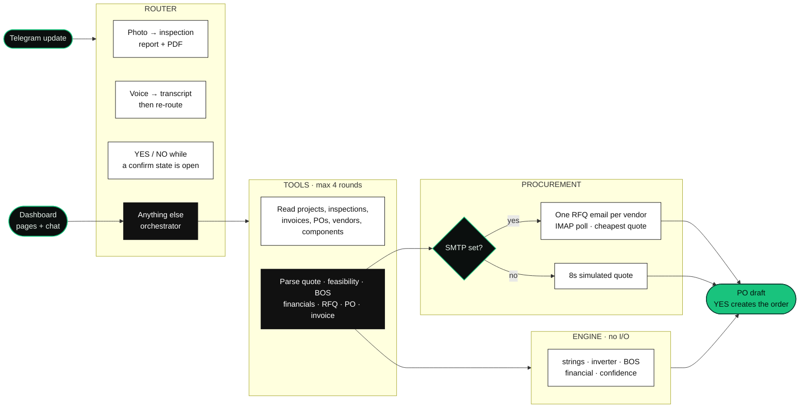
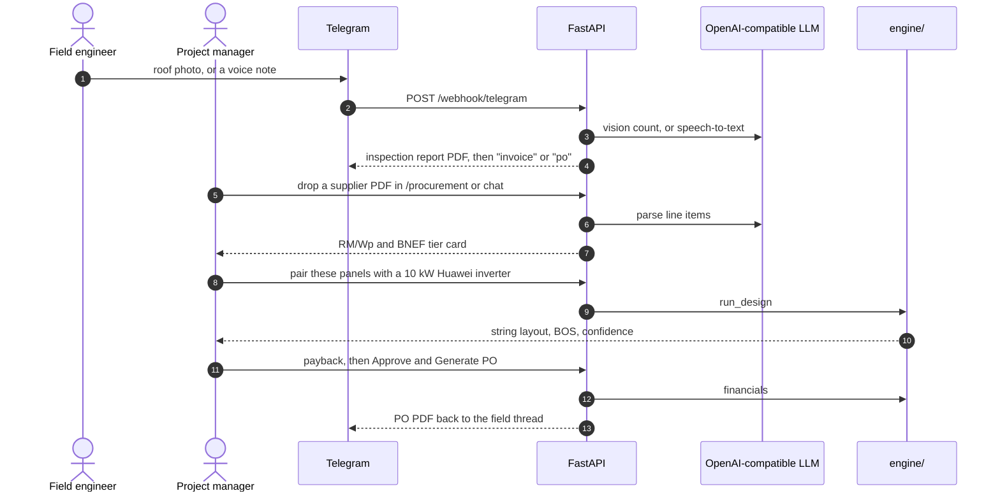

<p align="center">
  
</p>

<p align="center"><strong>🥇 1st place · KrackedDevs Vibe-a-thon 2026</strong></p>
<p align="center">
  
</p>
<p align="center">
  <sub>Project cover at <code>frontend/public/images/fieldbot-project-cover.png</code>. The sidebar uses <code>frontend/public/favicon.svg</code>.</sub>
</p>

<p align="center">
  <b>Photograph the roof. Parse the quote. Check the strings. Send the PO.</b><br>
  <sub>Telegram for the field engineer. A React dashboard for the project manager. An OpenAI-compatible model reads documents and picks tools. Every volt, ringgit, and confidence score comes from <code>backend/app/engine/</code>.</sub>
</p>

<p align="center">
  
  
  
  
  
  
  
  
</p>

---

## ▍The problem

Hardware on a solar job is a catalog line. The delay is everything around it. Supplier quotes arrive as messy PDFs, in mixed units and currencies. Pairing a module with an inverter means redoing string voltage, MPPT window, and DC:AC by hand. A payback number for a Malaysian site has to sit on TNB Regulatory Period 4 blocks and the Solar ATAP export rate.

`New_PRD.md` frames that overhead — estimating, procurement back-and-forth, engineering revisions, compliance — as 50% to 65% of project cost. That figure is the spec's problem statement, not a measurement from this repo.

SitePilot (codename FieldBot) is the loop for one EPC desk. A field engineer sends a roof photo or a voice note on Telegram. A project manager drops the quote into the dashboard, asks whether the panels pair with a named inverter, and approves a purchase order that goes back out on Telegram.

`plan.txt` is the original hackathon plan: a WhatsApp agent, a 4-day build, a 2–3 minute demo. The channel in the code is Telegram. `CLAUDE.md` describes what runs today.

## ▍The pipeline at a glance



| Stage | Where | What it decides |
| --- | --- | --- |
| **Route** | `app/agents/router.py` | Photos go to inspection: a report, a PDF, then a prompt to reply `invoice` or `po`. Voice, audio, and video notes are transcribed, then re-enter this table. `yes` / `approve` / `ok` and `no` / `cancel` only count while a confirm state is open. Everything else goes to the orchestrator. Procurement is not keyword-routed. |
| **Orchestrator** | `app/agents/orchestrator.py` | Tool choice. Off-domain questions get a fixed refusal and no answer. Loop cap is `MAX_TOOL_ROUNDS = 4`. With no `LLM_API_KEY`, both Telegram and `POST /api/chat/stream` return a static capability menu. Clear order, quote, feasibility, and payback phrasings force the matching tool on round 0 so the model cannot narrate a number it did not compute. |
| **Inspection** | `app/agents/inspection.py`, `services/llm_client.py` | Vision model returns panel count, issues, notes. No key: a stub seeded from the image byte length. |
| **Quote** | `app/agents/quote_parser.py` | Vision model extracts line items. Code normalises currency at `USD_MYR_RATE` (default 4.72) and RM/Wp, and checks the manufacturer against the local BNEF registry. |
| **Design** | `app/engine/report.py` `run_design` | String layout, inverter checks, BOS spec, TNB bill and payback, confidence. Pure Python. The model is told to quote tool results and not recompute them. |
| **RFQ** | `app/agents/procurement.py` | SMTP on: one `RFQ` row per matching vendor, shared `batch_id`, subject token `[FB-<token>]`. IMAP poller (default every 20s) parses replies. The PO draft is sent once, after every RFQ in the batch is no longer `sent`, or after `RFQ_BATCH_TIMEOUT_SECONDS` (default 120). SMTP off: 8 second delay, then a generated quote. |
| **PO** | `services/po_engine.py`, `services/pdf.py` | `YES` creates the purchase order, renders a PDF, and messages Telegram. A failed Telegram send is logged and does not roll back the database write. |

The same tool set serves the dashboard chat. Chat streams over SSE (`sse-starlette`) and can attach a card (`QuoteCard`, `FeasibilityCard`, `FinancialCard`, `PoCard`, and the others in `frontend/src/components/cards/`).

## ▍The demo

`New_PRD.md` §6 is the 4-minute hackathon script. `DEMO_CHECKLIST.md` is the prep list. `CHECKPOINTS.md` records an API-level dry run of that script and says a timed pass through the browser UI was not done.

The script's first minute has the photo trigger an RFQ by itself. In the code, a photo writes an inspection report, sends the PDF, and waits. The field engineer replies `invoice` to draft a progress claim, or `po` to ask for materials. The invoice row is saved as `draft` immediately; sending it to the customer waits for a later YES.

No UI screenshots are committed. `screenshots/` is gitignored. The image at the top of this file is the project cover.



Narrate the engine, not the leftover sentence in the PRD. Minute 2:15 of `New_PRD.md` still says the Longi Hi-MO7 550W + Huawei SUN2000-10KTL-M1 pairing (20 panels) is **3S × 5P** at **92%** confidence, with Vmp 124.5 V and cold Voc 148.8 V. That is the spec's 15-panel worked example pasted into a 20-panel scene. On a 120–500 V MPPT window the string search takes series max, which is 8. Full write-up: `checkpoints/PHASE_1A_ENGINE.md` and `ARD.md` §4.11.

What the tests lock for that pairing:

| | |
| --- | --- |
| Array | 11.0 kWp (`test_prd_demo_case`) |
| Layout | **8S × 3P**, status `pass` |
| String Vmp / Voc | 332.0 V / 396.8 V at 8 in series (8 × 41.5 V and 8 × 49.6 V), asserted on the wide MPPT window |
| DC:AC | 1.1 for 11 kWp on the 10 kW inverter. The 1.2–1.5 band check fails and the report adds `DCAC_RATIO_OUT_OF_BAND`. That check is not in the critical set, so overall status stays `pass` |
| Fuse | 20 A gPV |
| Confidence | Test asserts 90–94 and the hard cap of 94. `ARD.md` records **91** for this input set, with an `ORPHAN_PANELS` warning (8 × 3 = 24 slots, 20 panels on site) |

The 3S × 5P / 124.5 V / 148.8 V figures do reproduce when the inverter's MPPT window is narrow enough that series max is 3 (`test_string_design_narrow_mppt_window_matches_worked_example`, 15 panels).

Two seeded projects start empty so a live Telegram session writes real rows: **Greenfield Industrial Solar Phase 1** and **KL Tech Park Phase 2**. The other three projects carry fixed inspection, invoice, and PO history.

Messy quote PDFs are produced by `backend/scripts/generate_messy_quote.py` from seeded vendor and component rows. `*.pdf` is gitignored, so those fixtures are not in a fresh clone. Generate them after seeding, or drop your own PDF on `/procurement`.

## ▍Run it

Python 3.10 or newer (the backend uses `X | Y` type unions). Node and npm for the dashboard. Versions below are the pins in `backend/requirements.txt` and `frontend/package.json`. No Makefile.

Each process in its own terminal. On Windows, set `PYTHONIOENCODING=utf-8` before starting the backend if the console still cannot print emoji. `app/main.py` reconfigures stdout to UTF-8 when the stream allows it.

**Backend**

```sh
cd backend
python -m venv venv
# macOS / Linux
venv/bin/python -m pip install -r requirements.txt
# Windows
venv\Scripts\python.exe -m pip install -r requirements.txt
```

Delete `fieldbot.db` before a demo so the seed is not appended to an old file. Then:

```sh
cd backend
venv/bin/python -m app.seed          # Windows: venv\Scripts\python.exe -m app.seed
```

The seed prints its counts. The source lists **5 projects**, **6 vendors** (Green Energy Supply is the only BNEF tier 2; Borneo PowerTech is the only vendor with `quote_currency="USD"`), and the CEC CSVs load **45 modules** and **37 inverters**.

```sh
venv/bin/python -m uvicorn app.main:app --port 8000
```

That command binds IPv4 loopback (`127.0.0.1`). The dashboard calls `http://127.0.0.1:8000` (`frontend/src/lib/api.ts`). On Windows, `localhost` resolves to IPv6 `::1` first, and the browser waits out the dead address before falling back. If you override the base, keep it on `127.0.0.1` (`VITE_API_BASE`).

Swagger is at [http://127.0.0.1:8000/docs](http://127.0.0.1:8000/docs). On Windows, `uvicorn --reload` can stick after rapid edits and serve stale code. Kill the process tree and start again without `--reload`.

`python -m app.reset_demo` clears inspections, invoices, POs, quotes, RFQs, feasibility runs, chat, and the activity log. Projects, vendors, and components stay. The demo phone stays bound to the first project.

**Dashboard**

```sh
cd frontend
npm install
npm run dev          # Vite, default port 5173
```

| URL | What |
| --- | --- |
| [http://127.0.0.1:5173/](http://127.0.0.1:5173/) | Command Center. Fleet KPIs, trend, activity, docked chat |
| `/feasibility` | Project, module, inverter. `POST /api/feasibility/run`. Check matrix, confidence, Approve & Generate PO |
| `/procurement` | Drop a PDF or image. Upload, then parse |
| `/components` | CEC module and inverter catalog |
| `/projects`, `/projects/:id` | Project list and detail |
| `/vendors` | Seeded vendors |
| `/purchase-orders` | PO list |
| Chat on every page | `POST /api/chat/stream`. Same orchestrator as Telegram |

CORS in `app/main.py` allows `localhost:5173`, `localhost:5174`, `127.0.0.1:5173`, and `*.ngrok-free.app`. If Vite moves to another port, add that origin or the dashboard calls fail quietly.

**Keys**

The dashboard, the catalog, and the feasibility workbench run with no keys. Chat will not call tools until `LLM_API_KEY` is set. Photo analysis, quote parsing, voice, and email each have a stub.

```sh
# backend/.env  — names only; values stay out of git (.env is gitignored)
TELEGRAM_BOT_TOKEN=
DEMO_PHONE_NUMBER=0          # your numeric Telegram chat id, then re-seed

LLM_API_KEY=
LLM_BASE_URL=                # OpenAI-compatible. Code comments target DashScope / Qwen
LLM_TEXT_MODEL=
LLM_VISION_MODEL=

SMTP_HOST=
SMTP_PORT=587
SMTP_USER=
SMTP_PASSWORD=
SMTP_FROM=                   # defaults to SMTP_USER
IMAP_HOST=                   # Gmail SMTP implies imap.gmail.com
IMAP_USER=                   # defaults to SMTP_USER
IMAP_PASSWORD=               # defaults to SMTP_PASSWORD
RFQ_POLL_SECONDS=20
RFQ_BATCH_TIMEOUT_SECONDS=120

ELEVENLABS_API_KEY=
ELEVENLABS_VOICE_ID=
ELEVENLABS_STT_MODEL=scribe_v1

USD_MYR_RATE=4.72
```

**Telegram**

1. Message [@BotFather](https://t.me/BotFather), `/newbot`, put the token in `TELEGRAM_BOT_TOKEN`.
2. Message [@userinfobot](https://t.me/userinfobot). Set `DEMO_PHONE_NUMBER` to that numeric chat id and re-run `python -m app.seed`. The seeded session then binds your chat to the first project, so an inspection photo does not ask which project.
3. Expose port 8000 (`ngrok http 8000` is what the existing setup uses) and register the webhook. Substitute your own token and host:

```sh
curl "https://api.telegram.org/bot<TOKEN>/setWebhook?url=https://<host>/webhook/telegram"
curl "https://api.telegram.org/bot<TOKEN>/getWebhookInfo"
```

Restart the backend and DM the bot. A new tunnel only needs another `setWebhook`. `deleteWebhook` stops delivery. The Bot API has no daily message cap in this setup.

**RFQ email (optional)**

Leave SMTP blank and procurement stays on the 8-second simulated quote. To send real RFQs:

1. Gmail: turn on 2-step verification, create an [App Password](https://myaccount.google.com/apppasswords), use it as `SMTP_PASSWORD`.
2. Set `SMTP_HOST=smtp.gmail.com`, `SMTP_PORT=587`, `SMTP_USER`, `SMTP_PASSWORD`. IMAP fields can stay blank for Gmail.
3. Vendor and project addresses live in `app/seed.py` as plus-aliases. Point them at inboxes you control, then re-seed, or the RFQs go to those seeded addresses.
4. Restart. The log line is either `RFQ inbox poller started` or `IMAP not configured — RFQ inbox poller disabled (procurement uses simulated quotes).`

Reply with the `[FB-<token>]` still in the subject. A normal "Re:" keeps it. The poller matches that RFQ, extracts price and lead time, and asks the manager to approve.

**Voice (optional)**

`app/services/voice.py` calls ElevenLabs with `httpx`. No `ELEVENLABS_API_KEY`: `/api/voice/transcribe` returns the fixed line "Site has minimal shading, standard metal deck roof." and `/api/voice/speak` returns 204. The same stub covers a Telegram voice note.

**Quote fixtures and photo checks**

```sh
cd backend
venv/bin/python -m scripts.generate_messy_quote --vendor "<id-or-name>" --project "<id-or-name>" --out uploads/quotes/quote.pdf --seed 1
```

Drop images in `backend/uploads/` and run `venv/bin/python test_photos.py`. It calls `analyze_photo()` on every file in that folder and prints the vision result, skipping Telegram. `backend/uploads/*` is gitignored except the `uploads/quotes` directory entry; PDF contents still match the repo-wide `*.pdf` ignore.

**Tests and build**

```sh
cd backend && venv/bin/python -m pytest tests -q
cd frontend && npm run build    # tsc -b && vite build
cd frontend && npm run lint
```

`backend/tests/` is the engine plus the quote parser: 92 test functions, 113 cases once the parametrized currency, category, site-factor, and confidence-band cases are expanded. `npm run preview` serves the production build.

## ▍Repository map

```
SitePilot/
├── plan.txt                     original hackathon plan (WhatsApp, 4-day window)
├── CLAUDE.md                    how the code routes and persists today
├── ARD.md                       data model, API contract, design system
├── New_PRD.md                   product spec and the 4-minute script
├── DEMO_CHECKLIST.md            demo prep
├── CHECKPOINTS.md               phase log, including the API dry run
├── checkpoints/                 engine, ingestion, platform, frontend notes
├── backend/
│   ├── requirements.txt
│   ├── test_photos.py
│   ├── app/
│   │   ├── main.py              FastAPI, CORS, lifespan, IMAP poller
│   │   ├── config.py            env vars
│   │   ├── seed.py              5 projects, 6 vendors, CEC catalog
│   │   ├── reset_demo.py
│   │   ├── agents/              router, orchestrator, tools, inspection, procurement, quote parser
│   │   ├── engine/              strings, inverter, bos, financial, confidence, report — no I/O
│   │   ├── routes/              REST, SSE chat, voice, Telegram webhook
│   │   ├── services/            LLM, email, IMAP poller, PDF, PO, voice
│   │   └── data/                cec_modules.csv, cec_inverters.csv, bnef.py
│   ├── scripts/generate_messy_quote.py
│   └── tests/                   113 pytest cases
└── frontend/
    ├── package.json             dev, build, lint, preview
    └── src/
        ├── pages/               Command Center, feasibility, procurement, components, projects, vendors, POs
        ├── components/chat/     docked SSE chat, mic, dropzone
        ├── components/cards/    quote, feasibility, financial, PO, BOS, vendors
        └── lib/fixtures.ts      offline card payloads, corrected 8S × 3P figures
```

| Doc | |
| --- | --- |
| [plan.txt](plan.txt) | Original hackathon architecture. Keyword router, simulated procurement, WhatsApp. Superseded where `CLAUDE.md` differs. |
| [CLAUDE.md](CLAUDE.md) | Routing, orchestrator tools, RFQ email loop, stub behaviour. |
| [ARD.md](ARD.md) | Schema, formulas, API, and the corrected PRD demo case. |
| [New_PRD.md](New_PRD.md) | Problem statement, in-scope engine, explicit exclusions, 4-minute script. |
| [DEMO_CHECKLIST.md](DEMO_CHECKLIST.md) | What to click before a recording. |
| [checkpoints/PHASE_1A_ENGINE.md](checkpoints/PHASE_1A_ENGINE.md) | Why the demo narration said 3S × 5P and the engine says 8S × 3P. |

## ▍What this is, and isn't

- The LLM does not do arithmetic. Voltages, currents, string counts, fuse ratings, RM figures, and confidence come from `backend/app/engine/`. Confidence starts at 85, floors at 60, and hard-caps at 94. The disclaimer on the score is "AI-estimated, installer-confirmed".
- With no `LLM_API_KEY`, chat cannot reason or call tools. It returns the capability menu. Feasibility, the catalog, and the seeded dashboard still run. Photo analysis and quote parsing return stubs.
- Panel counts are a vision-model JSON reply, or a stub drawn from the file size. There is no trained detector and no accuracy figure in this repo.
- Procurement without SMTP is an 8-second simulated quote, not a vendor on the other end of an email.
- The CEC tables are a vendored CSV subset (45 modules, 37 inverters), described in `ARD.md` as an NREL/CEC library subset. They are loaded at seed. There is no live CEC feed and no `pvlib`.
- BNEF tier is a local name list in `app/data/bnef.py`, not a Bloomberg API.
- TNB RP4 sen rates and the Solar ATAP SMP (`ATAP_SMP_MYR = 0.18`) are constants in `app/engine/constants.py`. `USD_MYR_RATE` defaults to 4.72. Neither is a live tariff or FX feed.
- Seeded projects, consumption, and history are demo data. Greenfield and KL Tech Park start with no inspections.
- `plan.txt` specifies WhatsApp via Twilio. That webhook is not in the code. The live channel is `POST /webhook/telegram`. The orchestrator system prompt still calls itself a WhatsApp co-pilot.
- `New_PRD.md` excludes utility-bill OCR, the Google Solar API, and off-grid appliance surveys. `run_design` raises if `system_type` is `off_grid`. On-grid and hybrid are the supported types.
- Quote PDFs and UI screenshots are not in the clone. Generate quotes with the script. The 4-minute browser recording is a script plus an API dry run, not a committed capture.

## ▍Credits

| | |
| --- | --- |
| API | [FastAPI](https://fastapi.tiangolo.com/) 0.115, [Uvicorn](https://www.uvicorn.org/), [SQLAlchemy](https://www.sqlalchemy.org/) asyncio, [aiosqlite](https://github.com/omnilib/aiosqlite) |
| Dashboard | [React](https://react.dev/) 19, [Vite](https://vite.dev/) 8, [TypeScript](https://www.typescriptlang.org/) 6, [Tailwind CSS](https://tailwindcss.com/) 4, [React Router](https://reactrouter.com/) 7 |
| Field channel | [Telegram Bot API](https://core.telegram.org/bots/api) |
| Model | [OpenAI Python SDK](https://github.com/openai/openai-python) against `LLM_BASE_URL`. Comments in `orchestrator.py` and `llm_client.py` target Qwen on DashScope. The model id is the env var, not a hard-coded name. |
| Voice | [ElevenLabs](https://elevenlabs.io/) speech-to-text and text-to-speech, optional |
| PDFs | [ReportLab](https://www.reportlab.com/) for inspection, invoice, and PO documents, and for the messy-quote generator |
| Catalog | Vendored module and inverter CSVs. `ARD.md` D4 calls them a subset of the NREL/CEC library. |
| Tariffs | Constants in `app/engine/constants.py` for Malaysia TNB RP4 and Solar ATAP, as specified in `ARD.md` |

No contributor list or licence file is committed in this repo.

<p align="center"><sub>SitePilot, codename FieldBot. The original plan in <code>plan.txt</code> was a hackathon build: four days, a 2–3 minute demo. The 4-minute evaluation script is <code>New_PRD.md</code> §6. What the code does now is <code>CLAUDE.md</code>.</sub></p>
